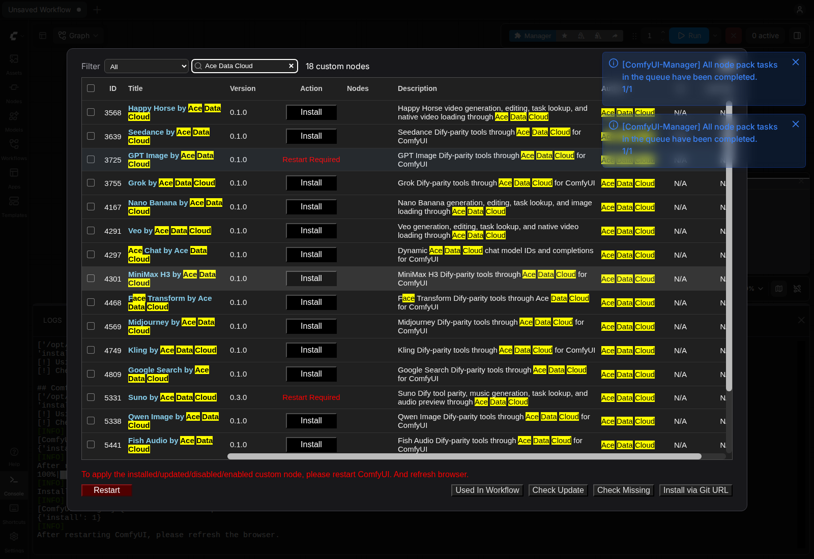
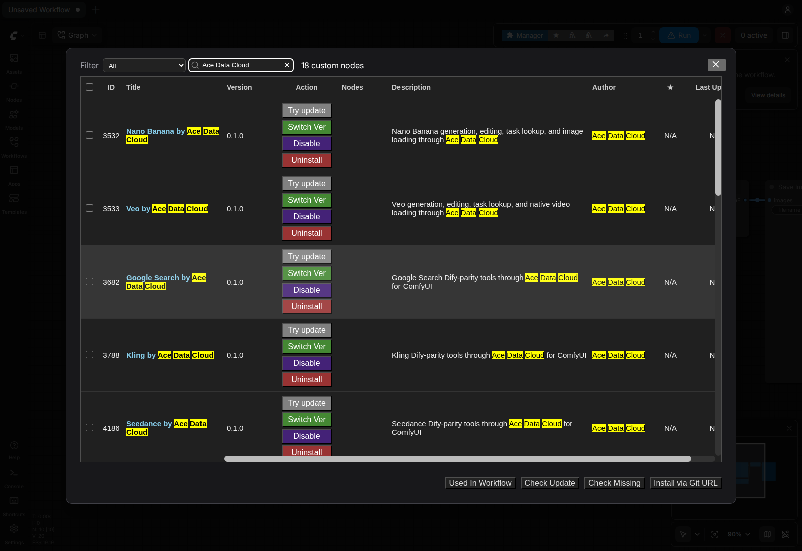

# Ace Data Cloud 的 ComfyUI Seedance 节点

在 ComfyUI 画布中通过 **Ace Data Cloud 使用 Seedance**：只提交一次，保存返回的任务 ID，再查询并预览或保存成品。独立安装本服务包，无需本地模型或显卡；收费以你自己的 Ace 账户权限、余额和当前价格为准。

生成前查看[当前模型价格](https://platform.acedata.cloud/models?utm_source=comfyui&utm_medium=referral&utm_campaign=evergreen&utm_content=seedancecomfyui_readme_zh_cn_pricing)与应用余额。

[English guide](../README.md)


## 当前版本与安装来源

本源码版本为 **0.1.2**，版本 ZIP 见 [GitHub Releases](https://github.com/AceDataCloud/SeedanceComfyUI/releases)。下文 Registry 安装段保留 **2026-10-19 已核 Active 的 0.1.0**；该旧 ZIP 尚不包含本版更新的图文、示例或修复。需要本版时，使用对应 GitHub Release ZIP，或等 Registry 中准确的 **0.1.2** 变为 Active 后再手选该版本；不要用默认 nightly 代替已核 stable。

从 GitHub ZIP 安装：停止 ComfyUI，先备份已有同名节点目录，把 ZIP 内文件解压到 `ComfyUI/custom_nodes/ace-seedance/`（不要多嵌套一层目录），在该目录运行 `python -m pip install -r requirements.txt`，然后重启并刷新。API Token 仍只配在实际启动进程环境中。GitHub ZIP 安装与 Registry/Manager 正式稳定版安装是不同路径。

## 官方安装

打开官方 [Seedance by Ace Data Cloud Registry 页面](https://registry.comfy.org/nodes/ace-seedance)，或在 **Manager → Custom Nodes Manager** 搜索 **Seedance**；找不到时再搜 **Ace Data Cloud**。选择 **Seedance by Ace Data Cloud**，核对发布者 **acedatacloud** 和源码仓库 [`AceDataCloud/SeedanceComfyUI`](https://github.com/AceDataCloud/SeedanceComfyUI)，再点击 **Install**。在 **Select Version** 版本对话框明确选择已批准的 Registry 稳定版 **0.1.0**；普通对话框可能默认高亮 **nightly**，本教程不要直接接受该选项。保留依赖自动安装。出现 **Restart Required** 后重启 ComfyUI，并刷新浏览器。Registry ID 为 `ace-seedance`。





以上原图来自 **2026-10-16、Linux ComfyUI 0.41.0** 的发布者品牌搜索安装验收，不是本轮新生成，也不是服务词搜索实拍；见[图片来源与边界](screenshot-sources.json)。

这条 Registry 稳定版安装路径已于 **2026-10-16 在原版 Linux CPU ComfyUI 0.41.0** 验证；该次安装验收没有提交生成或聊天请求。更新的宿主版本及每个收费动作仍需分别验证，模型可用性与价格以当前服务规则为准。

## 注册并获取 API Token

### 复制或创建自己的 API Token

Ace 应用页与其他集成共用：图中 **1** 复制已有 Token，**2** 打开**管理 Key**，再选**创建**。新账户先注册/登录并初始化**通用应用**；确认本服务权限、当前价格、余额、有效期和允许的 API 限制。


以上是 **2026-10-08** 的真实脱敏 Ace 控制台原图，复用自 SunoDify；第二图示例名为 `Dify tutorial`，此处请命名为 `ComfyUI`。本次未创建凭据。Token 只配在**启动 ComfyUI 的进程环境变量** `ACEDATACLOUD_API_KEY` 中并重启；节点没有图示的 Key 输入框，不要贴进提示词、JSON 参数或工作流文件。其他终端的 export 不会配置已经运行的 Desktop 进程。

1. 登录 [Ace Data Cloud → 应用](https://platform.acedata.cloud/console/applications?utm_source=comfyui&utm_medium=referral&utm_campaign=evergreen&utm_content=seedancecomfyui_readme_zh_cn_api_key)。新账户没有通用应用时，先选择**初始化通用应用**。
2. 打开**通用应用**，确认已开通本节点使用的服务。单服务应用的 Key 只限该服务。可复制已有 API Key；需要独立 Key 时，选择**管理 Key → 创建**，命名为 `ComfyUI`。
3. 只复制 Token 字符串，不加 `Bearer ` 或引号。平台管理 Token 不能代替节点调用 API 的 Key。若启用**允许的 API**限制，需同时包含工作流用到的提交和任务查询路径；收费动作前核对当前价格与 Credits 余额。

终端启动示例（只在私有终端粘贴自己的 Token，然后从同一终端启动）：

```bash
export ACEDATACLOUD_API_KEY='在此粘贴自己的私有Token'
python main.py --cpu
```

在**实际 ComfyUI 进程环境**中设置 `ACEDATACLOUD_API_KEY`（也接受 `ACEDATACLOUD_API_TOKEN`），不要写进工作流或仓库。每个 Dify 工具对应一个节点；model/action 选择器覆盖 Dify YAML 的固定选项，其他字段有具名输入框，留空则省略。数组/对象字段在输入框填 JSON 字符串；高级参数也可放进 `parameters_json` JSON 对象，非空具名字段优先。选 `(from JSON/default)` 则使用 JSON 或 API 默认值。任务查询节点可填 `task_id`，批量查询节点可填 `ids_json`。完整字段和 model 列表见[英文主文档](../README.md)。

导入 [01-configure-and-run.json](../examples/01-configure-and-run.json)，先填任务 ID 或 JSON 参数再运行。提交成功不代表媒体完成；用同一个任务 ID 查询至 `succeeded`，把 Ace CDN URL 接到相应 `VIDEO` 节点。收费提交失败时不会自动重试，先查请求记录和价格。删除/归档类动作仍需在 JSON 明确设置 `confirm: true`。详见[隐私说明](PRIVACY.md)。

## 首次工作流：提交一次，再查询原生成品

1. 通过 **File → Open** 导入 [02-submit-once.json](../examples/02-submit-once.json)。确认 Seedance 权限、所选模型与当前价格后，这张**收费提交**工作流只运行一次，从 Preview as Text 复制 task ID；不要把整张生成图用于轮询。
2. 导入 [03-retrieve-native-media.json](../examples/03-retrieve-native-media.json)，粘贴同一个 ID。图中连接 **Retrieve Task → Load Video → Save Video**，状态另有文本预览；这张图不会新建生成任务。
3. 只有状态 succeeded 且成品能预览/保存才算完成。pending 时只重跑查询图；提交超时没拿到 ID，先查请求记录再决定是否付费重发。

这些是可导入配置文件，2026-10-18 已离线校验 API 合同和连接；没有新收费调用，也没有声称已实拍新工作流。


在 ComfyUI 中取消会在下一次中断检查时停止本地任务轮询与重试等待；已经发出的 HTTP 请求可能先完成或超时。这不会取消已经接受的远端任务或自动退款；保留同一任务 ID，重发收费提交前先查请求记录。

## 使用记录与排错

若 Key 启用了**允许的 API**限制，Seedance 工作流需允许实际使用的路径：`/seedance/videos`、`/seedance/tasks`。收费提交前，在 Ace 控制台确认服务权限、Key 有效期、Credits 余额与所选模型当前价格；ComfyUI Credits 不用于支付这个 Ace API Key 的调用。

| 现象 | 处理 |
| --- | --- |
| 缺 Key 或 HTTP 401 | 将 API Token 配在实际启动 ComfyUI 的进程环境中并重启。平台管理 Token 或另一个终端的 export 不能代替该配置。 |
| HTTP 403 | 先读具体错误，区分服务权限、Key 限制或内容限制，修正有权限的请求；不要盲目重复提交。 |
| HTTP 429 | 等待服务限流恢复；保留已接受的任务 ID，只查询该任务，不另发生成。 |
| pending 或暂未预览 | 只运行查询工作流，使用同一个任务 ID；提交成功不代表媒体已经完成。 |
| 提交超时或 HTTP 5xx | 重发收费提交前先查控制台请求记录。已有任务 ID 就查询原任务，不通过重复付费生成轮询。 |
| 已完成但媒体加载失败 | 确认状态为 `succeeded`，使用该任务实际返回的 Ace CDN 媒体 URL，核对原生加载节点输入与宿主兼容性；不要用再次付费生成替代缺失结果。 |

查询节点每次队列执行都会重新读取同一任务，不复用旧pending结果；收费提交在输入不变时仍保留缓存，避免查询时重发收费生成。导入或运行工作流前先关闭自动队列/自动运行，提交图只明确运行一次。
